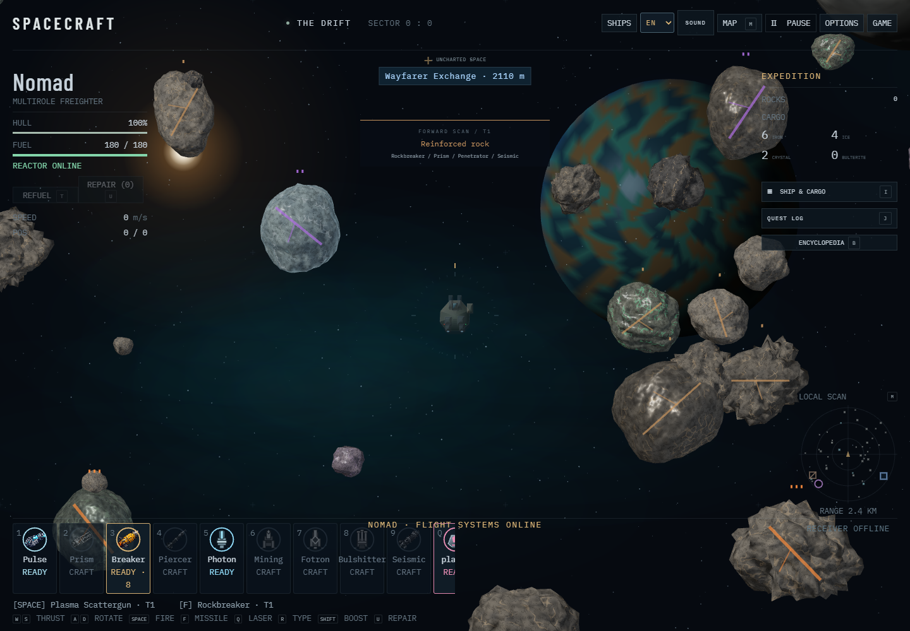
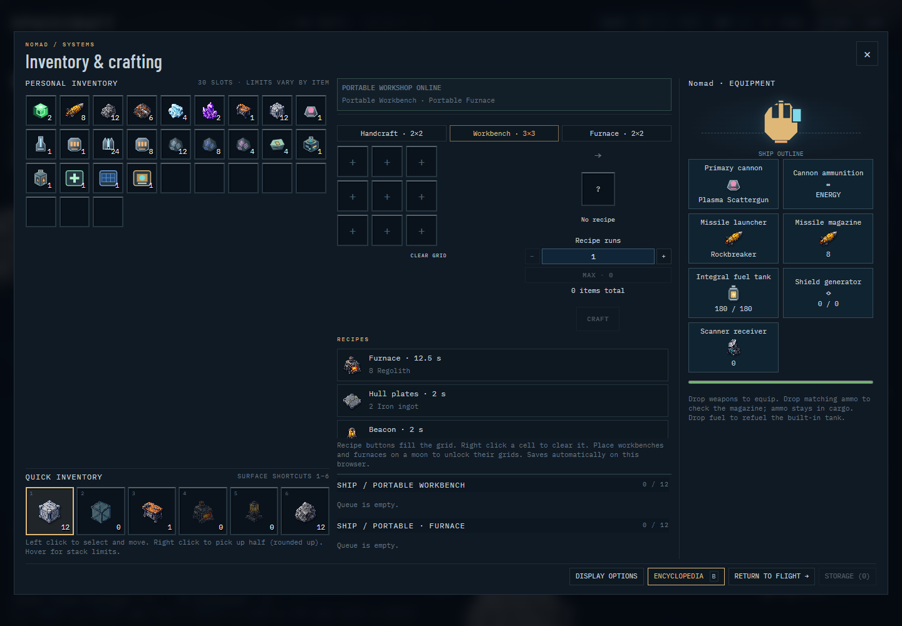
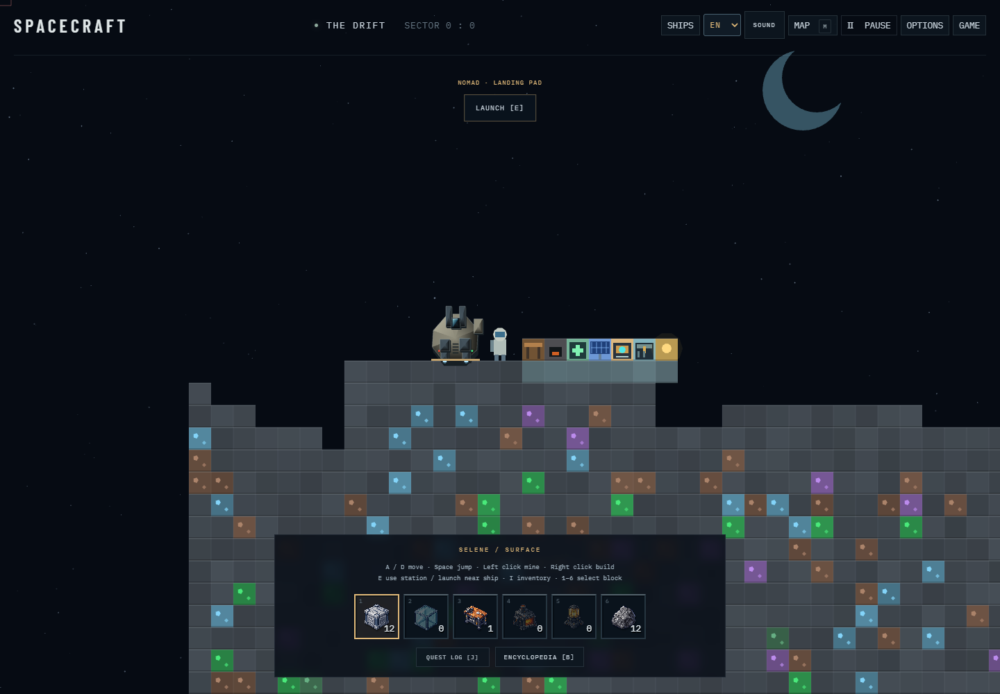

# SPACECRAFT

SPACECRAFT is a browser space exploration and survival game with Asteroids-style flight and combat. Choose a ship, venture into an expanding universe, and blast asteroids for the materials you need to keep exploring.

Turn ore, ice, and crystals into fuel, ammunition, machines, and ship upgrades. Manage your cargo and equipment, unlock stronger weapons and shields, and land on moons to mine rare deposits and build bases with workshops, furnaces, storage, and support buildings.

Travel through wormholes to discover new systems, take on quests, trade at starbases, and recruit crew members with useful skills. Space pirates, tough asteroid fields, and dangerous black holes make preparation matter: watch your fuel, protect your hull, and build a network of outposts to support longer expeditions.

Play in English or Czech, with named local save profiles so you can return to your expedition.

[Play SPACECRAFT in your browser](https://mykkro.github.io/spacecraft/).

For code structure, shared-state rules, and lightweight development checks, see
[SOURCE_GUIDE.md](SOURCE_GUIDE.md).

A dependency-free WebGL space game. Open `index.html` in a modern desktop browser, or serve this directory with `python -m http.server 3333` and visit http://localhost:3333.

Inventory, equipment slots, and portable crafting stations:

A Selene outpost with workbench, furnace, repair station, solar array, fabrication hub, storage, and beacon:

- **W / S**: thrust / reverse
- **A / D**: rotate (arrow keys also work)
- **Space**: pulse cannon
- **F**: fire the selected missile (starts with Rockbreaker)
- **Q**: cycle primary weapon; **R**: cycle missile type
- **1–5** in space: select a weapon directly, or click its HUD card
- **Shift**: boost
- **I / Tab**: ship and cargo
- **P / Escape**: pause
- **M**: local space / global systems map (also available from the Map button)
- **V**: mute / unmute; open **Sound** in the header to adjust volume
- **J**: quest log (also available from the Expedition Log and surface HUD)

## Quests and rewards

Five simple contracts track automatically. Open **J**, check progress, and claim each reward once:

| Quest | Objective | Reward |
| --- | --- | --- |
| Crystal prospecting | Mine and collect 12 crystal | 8 iron ingots, 4 hull plates |
| Heavy metal | Mine and collect 24 iron ore | 16 base blocks, 8 glass blocks |
| Cold storage | Mine and collect 16 ice | 4 crystal, 4 iron ingots |
| A place to call home | Establish 1 base | 1 beacon, 4 hull plates |
| An interstellar foothold | Maintain 3 bases on different moons | 1 scanner receiver, 1 Seismic Torpedo |

A **base requires at least one placed workbench**. Multiple workbenches on one moon still count as one base. Buildings without a workbench are outposts. Existing saved bases qualify, and removing the last workbench removes that moon from an unclaimed base objective. Claimed rewards stay claimed.

Mining progress counts successfully collected asteroid minerals and mined moon deposits. Starter supplies, pirate salvage, crafted items, and quest rewards do not count as mining. Spending mined materials does not reduce progress, and claiming a reward does not consume the mined cargo. Mining counters start with this update; old inventory is not assumed to have been mined.

Quest progress and claimed rewards are stored together with inventory in the game save. The entire reward must fit within the item's stack limits; otherwise the claim stays available until you free space. Place held items before claiming. Opening the log pauses flight and can sit above an existing inventory or map screen. The implementation is in `js/quests.js` and `css/quests.css`; no browser test is launched automatically.

## Sound

Sound effects are synthesized locally with the Web Audio API; no audio downloads or dependencies are needed. Each weapon has a distinct firing sound. Thrust uses a continuous engine rumble with different pitch and intensity for reverse and boost. Impacts, blocked shots, collisions, asteroid and pirate explosions, crafting, mining, building, pickups, landing, launch, wormhole transit, and pirate alerts have their own cues.

Audio starts only after a click or keypress. Header controls save volume and mute settings in this browser, and **V** toggles mute. The engine stops while paused or on a surface. Losing focus or hiding the tab silences audio. Distant combat sounds fade with distance and pan left/right. A shared noise buffer, a 24-voice limit, per-effect rate limits, and a compressor keep the sound system small and control the mix. Unsupported audio falls back to silent gameplay.

The implementation is in `js/audio.js` with styles in `css/audio.css`. Audio changes were checked with lightweight syntax/source checks; browser playback was not tested, in accordance with the repository's testing policy.

## Scanner, maps, and wormholes

Craft a **Scanner Receiver** at a workbench using 3 iron ingots, 2 hull plates, 1 glass block, and 1 crystal. Carrying it automatically powers the receiver; no extra installation step is needed. It detects wormholes within **6.5 km**, adds cyan directional arrows to the minimap for offscreen signals, and locates their destination systems. Selecting a signal on the local chart tracks its bearing in amber. The receiver has its own generated inventory icon.

Press **M** for the navigation screen:

- **Local Space:** your ship, nearby moons, asteroid field, receiver range, and detected wormholes. Select a marker or use the sidebar to inspect it. Select a wormhole to track it.
- **Global Systems:** only systems you have located or visited, with known wormhole connections. Hollow circles mean located; filled circles mean visited; amber marks your current system. Selecting a system shows its details.
- Scroll or use **+/−** to zoom, drag to pan, and use **Fit** to reset. **M / Escape** closes the chart. The map pauses flight and restores an existing inventory screen when closed.

Each deterministic system occupies a 12 km-wide region of the infinite flight world. Four reciprocal wormhole connections lead to neighboring systems, so exploration can continue indefinitely. Wormholes are visible when you fly close even without a receiver, but long-range bearings and remote destination discovery require the receiver.

Approach a wormhole within **120 m**, slow below **160 m/s**, and press **E** or use its entry button. Transit places you safely beside the paired exit, stops your ship, and briefly locks re-entry. Systems are marked **visited only when you physically enter them**, by wormhole or ordinary flight. The chart, discovered links, tracked bearing, and visits persist in browser local storage. Moon bases remain at their original world coordinates through travel.

Explore a procedurally generated universe. Large rocks take multiple cannon hits or a missile and split into three smaller rocks. Small rocks release iron ore, ice, or crystal; fly near the fragments to collect them. Collisions damage your hull; hull loss triggers recovery at the origin.

## Space pirates

Some systems have quiet space; others contain one or two deterministic pirate patrol zones. The first is **Gallows Run**, southeast of the starting point near **(3300, 1700)**. The local map outlines danger zones in red and lets you inspect them. Global charts mark pirate activity for located systems. Nearby hostile ships appear as red triangles on the minimap without requiring the wormhole receiver.

Scouts and heavier raiders patrol their territory, pursue nearby ships, and fire orange plasma bolts that damage your hull. Their pursuit has a limited range, so you can boost away. Asteroids block both enemy and player shots. All player weapons damage pirates, and Seismic Torpedoes can hit several ships in one blast. Enemies show hull bars during combat and leave iron ore and crystal salvage when destroyed.

The starting area and immediate wormhole approaches are protected. Pirates do not attack during surface exploration, and opening a map or inventory pauses combat. Defeated patrol members remain defeated across reloads and system changes; cleared zones are marked on the map. Surviving pirates reset to their patrols when a system is re-entered or the game reloads. Losing your hull uses the existing emergency recovery at the origin and clears incoming fire.

Combat and patrol persistence live in `js/pirates.js`; ship models are drawn procedurally in WebGL. Run `python tests/python/verify_pirates.py` for the isolated browser checks.

## Weapons and asteroid hardness

Every weapon has a generated item icon and a circular recharge arc. Empty arcs fill clockwise to ready, with remaining seconds beneath them. Primary weapons share one cooldown and missiles share another, so switching types does not bypass a recharge. Cooldowns freeze while paused or exploring a moon.

| Weapon | Tier | Damage | Recharge | Access |
| --- | --- | --- | --- | --- |
| Pulse Cannon | 0 | 1 | 0.15 s | Built in |
| Prism Laser | 2 | 4 | 0.38 s | Craft at workbench |
| Rockbreaker | 1 | 8 | 1.8 s | Built in |
| Penetrator | 2 | 12 | 2.6 s | Craft at workbench |
| Seismic Torpedo | 3 | 20 | 4.2 s | Craft at workbench; area blast |

Advanced launchers are reusable equipment and consume matching ammunition with every shot. Craft a weapon, then select it in inventory and press **Equip**, click its HUD card, or cycle to it. Locked cards show **Craft**. Craft ammunition separately at a workbench; recipes list the material costs.

Standard rocks accept any weapon. Reinforced rocks (copper seams, one tick) require tier 1 or higher. Resonant rocks (violet seams, two ticks) require tier 2 or higher. Ultradense cores (orange seams, three ticks) require the Seismic Torpedo. Weak weapons do **zero damage** regardless of hit count. Aim at a rock to see its hardness and compatible weapons in the forward scan. Fragments lose one hardness tier when a rock breaks. Fast projectiles use swept collision tests, and blast damage respects hardness.

## Bases on the maps

Building a construction block, glass block, workbench, furnace, or beacon establishes a moon outpost. Each settled moon has one green house marker on the minimap and the **M → Local Space** chart. Saved bases are indexed from their actual terrain, including older saves; mining away the last constructed module removes the marker.

The smaller green circle marks the moon outpost footprint. A placed beacon adds a **1.2 km signal coverage radius**, shown as a larger green circle with the footprint still visible inside it on the local chart. These rings describe outpost and navigation coverage; combat protection and repair effects are not part of this overlay. Nearby offscreen bases have a green direction marker on the minimap. Your own base locations are available without a scanner receiver.

The local chart's **Bases & Outposts** list shows distance, module count, and radius. A workbench establishes a base; other construction is labelled as an outpost. Click a marker or list entry for its beacon and crafting station details. Coverage updates when construction changes, and base metadata is cached so radar frames do not scan surface terrain grids.

## Inventory and crafting

Press **I** for a 30-slot inventory. Each item defines its own `maxStack`; hover a slot to see its limit.

| Items | Stack limit |
| --- | --- |
| Regolith, iron ore, base blocks | 64 |
| Ice, iron ingots, glass blocks | 32 |
| Crystal, hull plates | 16 |
| Beacons | 8 |
| Workbenches, furnaces | 4 |
| Weapons, scanner receivers | 1 |

Left click a stack, then another slot to move or merge it. **Right click a stack to pick up half**, rounded up for odd quantities. A held stack follows the pointer: left click deposits or merges as much as fits, and right click places one item. Partial merges keep the remainder in hand; full or incompatible stacks reject single-item placement. Left clicking a different item while holding a stack swaps them.

**Return to Bag** returns held items to available space. Closing the inventory attempts the same; if the held items cannot fit, place them before closing. Held items are saved, so reloading does not discard them. Older oversized stacks are split automatically. Any excess that cannot fit stays in **Saved Cargo Overflow**; free slots and choose **Recover Cargo** to bring it into the bag.

Select an item or hold a split stack and click crafting cells to assign ingredients; right click a cell to clear it. Place held items before crafting. Recipe buttons fill the required pattern automatically. Ingredients are reserved when you press **Queue Craft**. Finished batches wait safely in the crafting queue until there is room for the full output.

- Handcraft (2×2): regolith → base blocks or workbench.
- Workbench (3×3): regolith → furnace; iron ingots → hull plates; ingots + crystal → beacon; ingots + plates + crystals → advanced weapons.
- Workbench (3×3): ingots + plates + glass + crystal → scanner receiver.
- Furnace (2×2): iron ore → iron ingot; ice + crystal → glass blocks.

Place stations on a moon to access their grids through **I** anywhere on that surface or from low orbit (within 220 world units of the moon’s edge). The inventory shows the connected moon and its stations; use the Workbench and Furnace tabs to switch grids. Carrying an unplaced station does not unlock it. Mining the last station of a type disables that grid immediately. Fabrication uses a timed, saved queue without additional furnace fuel. Hull plates are stored items for future ship upgrades.

## Landing and bases

The first moon, **Selene**, is northeast of the starting point (720, −600). Approach slowly and press **E** or click **Land** when prompted (below 160 m/s). More moons appear throughout the universe.

On the surface: **A/D** move, **Space/W** jump, hold **left click** to mine, **right click** to place the selected hotbar item. **1–6** select base blocks, glass, workbench, furnace, beacon, or regolith. Mining/building is limited by reach and line of sight. Blocks require an adjacent block. Walk near your ship and press **E** or click **Launch** to leave. Away from the ship, **E** opens available station grids.

You start with a small supply of regolith, ore, ice, crystal, base blocks, and one workbench. Your inventory, built moon surfaces, ship position/hull, and surface location save automatically in browser local storage. No account or server is needed. Saves are specific to the browser and origin; file URLs and localhost may have separate saves. Crafting/building saves immediately; movement saves periodically.

Rendering uses native WebGL with procedural volumetric asteroid meshes and no runtime JavaScript dependencies. Generated pixel-art item icons are bundled locally in `assets/items/`; their prompts are documented in `ICON_ART.md`. Google Fonts are optional; system fonts are fallbacks. Flight lives in `js/game.js`; combat and the weapon HUD live in `js/weapons.js`; item definitions, recipes, persistent moon terrain, and surface play live in `js/systems.js`; navigation and exploration knowledge live in `js/navigation.js`. Larger ships and ship equipment editing remain future work. Desktop keyboard and mouse are required.

Browser regression checks: `python tests/python/verify_browser.py --file`, `python tests/python/verify_weapons.py`, and `python tests/python/verify_navigation.py` (Python Playwright required). They use isolated contexts and leave the player's save alone.

Missiles use finite ammunition: you start with 8 Rockbreaker rounds. Workbenches craft separate Rockbreaker (4), Penetrator (3), and Seismic (1) ammo batches; stack limits are 16, 8, and 4. Weapon cards show remaining rounds beside the circular cooldown. Empty launchers cannot fire. Most primary weapons use energy; Fotron and Bulshitter consume their own craftable ammunition. Pirate salvage always includes basic ammo, heavy ships also carry advanced rounds, and some ships drop equipment. Fly close to collect salvage; free inventory space for each pack. Existing saves receive the starter ammo once.

Czech localization: choose **CZ** or **EN** in the header. Czech is selected automatically for browsers with a Czech language preference on first visit. Changing language saves your expedition and reloads the interface; the choice is stored separately from gameplay. Item IDs, recipes, controls, and existing saves are unchanged. Translations live in `js/i18n.js`; dynamic UI uses `I18n.t` for plain text and `I18n.html` for markup, keeping identifiers and asset paths intact.

Ship selection appears before your first flight (including older saves without a preset). Use **SHIPS** in the header to change later. Starfox: 18 slots, 700 m/s, agile; Kraxna 1: 60 slots, 340 m/s, tough hull, enhanced mining laser; Nomad: 30 slots, 520 m/s, balanced, Photon Cannon. Switching preserves hull condition, position, equipment, ammo, and all cargo; excess stacks remain recoverable in reserve. Cargo mass reduces acceleration and top speed, with haulers tolerating heavier loads.

Bulterite (**Bulterium** in Czech) is a dense, durable resource with 8 per stack and 12 mass per unit. Find its green mineral veins in space and deep moon deposits; Fotron or Seismic equipment is required to extract it. Heavy pirates can also carry it. Use it to forge hull plates and build the **Fotron Cannon** (tier 3, stronger than Photon). **Bulshitter** (**Bulšitr** in Czech) fires five weak, rapid spread shots for small rocks and scouts; it cannot break reinforced targets. Craft the new energy weapons at a workbench. Use **Q** to cycle primaries or **1–9** to equip HUD cards.

New material and weapon icons are local SVG artwork in `assets/items/`. Run `node tests/js/verify_ships.js` and `node tests/js/verify_localization.js` for dependency-free model checks; these start no browser or graphics context.

Fuel: watch the tank meter beneath hull integrity. Forward/reverse thrust burns fuel; boost burns three times as much. Coasting, rotating, pausing and surface exploration do not use flight fuel. Empty tanks leave 12% solar thrust with boost disabled. **T** or **REFUEL** uses a basic Fuel Cell first, then a green Ion Cube, then blue. You can select a specific fuel stack in inventory and press **REFUEL**. Fuel Cells provide 20 units, green **Ion Cubes / Iontové kostky** provide 80, and **Blue Ion Cubes / Modré iontové kostky** provide 320. Any charge beyond tank capacity remains in the inserted cell and feeds the tank automatically; no fuel is wasted, and another cell cannot be inserted until this charge is used. Starfox/Nomad/Kraxna tank capacities are 100/180/300. Switching ships preserves total fuel. New expeditions and older saves receive a first tank and two green cubes once. Find cubes in asteroids, deep moon deposits and pirate salvage, or craft fuel at furnaces/workbenches. Fuel and remaining cell charge persist with your expedition.

Base navigation: the minimap shows all saved bases and outposts, with green edge arrows for distant locations, without requiring a scanner. The nearest base (or the base you select) is listed below the radar with distance and compass bearing. Both map views list every saved base; the local view retains coverage circles and the global view marks systems containing bases. Select a base from either list to highlight its bearing in amber. Selecting a base in another system opens the global chart. Bearings are direct directions, not wormhole routes. The selected base persists across reloads.

Open the **Encyclopedia** with **B** or its button in the expedition log, inventory or surface HUD. Browse all items, including uncrafted equipment, with icons, descriptions, stack limits, mass, fuel/weapon stats and crafting grids. Filter by category or search names and descriptions; Czech search also accepts text without accents. Ingredient and crafting-use links open related entries. The guide pauses play and restores the previous menu when closed; browsing does not change inventory or consume fuel.

Customize **Quick inventory** in the inventory screen: select a stack and click a numbered slot, or press **1–6** while the inventory is open. Drag a bag item onto a quick slot to assign it, drag one quick slot onto another to swap, and right-click a slot to clear it. Assignments are saved and reference bag contents without moving or duplicating items. Surface **1–6** uses the assigned slot: building items select a block, fuel refuels, and weapons equip. Other materials can be pinned for counts but cannot be placed as terrain. Flight weapon shortcuts remain shown on the weapon cards.

## Starbases and crew

The first civilian station, **Wayfarer Exchange**, is southeast of the start at **(1800, 1100)**. Every system has a station, with a blue square bearing on the minimap and markers on local/global maps. Approach within **260 m**, slow below **100 m/s**, then press **H** or click the station prompt. Docking pauses play. **H / Escape / Undock** resumes flight.

You start with **120 credits** and yourself as captain. Sell minerals to earn credits, buy fuel or missile ammunition, and repair your hull for one credit per missing percentage point (rounded up). Market quantity controls support bulk buying and selling; purchases require cargo space. Stations offer three permanent hires, for a maximum crew of four:

- **Rhea, miner (80 cr):** +25% asteroid damage. Weapon hardness gates still apply; pirate damage is unchanged.
- **Tarek, engineer (110 cr):** 20% lower flight fuel use, including boost.
- **Ada, mechanic (100 cr):** repairs 1% hull per five seconds after eight seconds without damage, during active flight.

Each specialist can be hired once. Credits, crew and station discoveries share the expedition save with cargo. The station interface supports English and Czech. Run `node tests/js/verify_starbases.js` for browser-free model checks.

Kraxna's player captain is **Jegor Kokotovič**, captain and space garbage man. Its starting two-member crew includes repair robot **Bobo**, who makes station hull repairs **50% cheaper**, rounded up to whole credits. Bobo has a separate robot berth, so Kraxna can still hire all three specialists (five crew in total). Starfox starts with captain **Mara Voss**; Nomad starts with captain **Viktor Vale**. Each begins as a one-person crew. Built-in crew follows the selected ship; hired specialists are retained when switching, and Bobo is never duplicated. The ship picker and station roster show this crew in English/Czech.

## Delivery, escort and navigation rewards

Open **J** for contracts, or choose **Contracts** while docked. Mining/base contracts still track automatically; delivery and escort contracts have **Accept** buttons.

- **Crystal prospecting:** its existing item rewards now also reveal the real **0:0 → 1:0 wormhole**. Coordinates work without a scanner and do not mark the destination as visited. Older saves with this quest already claimed also receive the coordinates.
- **Metal across the void:** accept to receive the route from 0:0 to 1:0. Bring **8 iron ingots** to the civilian starbase in **system 1:0**, dock, open Contracts, and claim. Claiming consumes the ingots and pays **180 credits**, plus wormhole coordinates **1:0 → 1:1**. The destination station appears on the global map after acceptance.
- **A courier needs cover:** accept in space in system **0:0**. Meet the transport at **(-1800, -900)** and escort it to **Wayfarer Exchange (1800, 1100)**. It moves while you stay within **900 m**; the HUD, minimap and local map show its position. Two pirate ambushes target it along the route. Shoot them with your normal weapons or intercept their fire; asteroids block bullets. Completion requires the courier to reach the station alive, all attackers/bullets cleared, and you within **650 m**. Claim **180 credits and 4 hull plates** in the quest log.

A destroyed courier or leaving system 0:0 fails the escort. Return to that system and choose **Retry Escort**; contract pirates drop no salvage to avoid restart farming. Docking, menus and surface play pause the simulation. Mission progress, courier hull, live attackers/bullets and credit rewards persist with the expedition. Full cargo holds block item payouts without losing completion; claims pay only once.

Run `node tests/js/verify_missions.js` for dependency-free mission checks without opening a browser.

## Display, realistic surfaces and outfitting

Asteroids now use cached irregular surface meshes, world-space lighting, crater bowls and mineral seams. Player ships, pirates and the mission courier use shaded hull plates with thickness, canopy reflections, engine housings and navigation lamps. Ships and effects use the existing triangle batch; volumetric asteroids now use a dedicated depth-tested pass. Flight is top-down, with gravity hazards affecting trajectories.

Choose **OPTIONS** in the header, or **DISPLAY OPTIONS** in inventory. HUD text starts at **125%**, with a saved **100–160%** size slider, high-contrast panels and an option to hide flight-control hints. These preferences stay local to the browser.

Inventory fits inside the viewport: its shell and footer stay fixed while cargo, workshop/recipe lists and ship equipment scroll internally. Drag stacks between bag slots to move, merge up to the stack limit, or swap different items. **Shift-drag** moves half (rounded up); partial stacks do not swap with incompatible items. Right-click half-stack controls still work. Drop items on crafting cells to assign ingredients; the items remain in cargo until crafting. The inventory quickbar and surface quickbar accept item assignments and shortcut swaps.

The ship outline has sockets for the primary cannon, cannon ammo, missile launcher, missile magazine, built-in fuel tank and scanner. Drop or select/click a compatible weapon to equip it. Ammo sockets show the compatible stock used directly from cargo; they do not create duplicate stacks. Drop fuel on the tank socket to refuel. Tank capacity belongs to the selected ship; this screen does not add interchangeable tank upgrades.

**Fotron** now needs **Fotron charge cells** (32 per stack): a workbench crafts **24** from two crystals, one green Ion Cube and one Bulterite. **Bulshitter** needs **cartridges** (128 per stack): a workbench crafts **80** from two iron ingots and one iron ore. A cartridge fires the whole five-projectile volley. Empty weapons cannot fire, and cooldown failures do not spend ammo. Both ammo types appear in the encyclopedia.

Focused checks: `node tests/js/verify_visual_models.js`, `node tests/js/verify_special_ammo.js`, `node tests/js/verify_inventory_drag.js`, and `node tests/js/verify_display_options.js`. All run without browsers or graphics contexts.

## Timed crafting queue

Crafting is no longer instant. Choose a recipe and press **Queue Craft** to reserve its ingredients and add one recipe batch to a **12-job FIFO queue**. Each available station processes one job step at a time; workbench and furnace can work in parallel. Recipe buttons show the duration, and the workshop has progress bars, remaining seconds, station status and cancellation buttons. The flight HUD also shows queued fabrication.

| Output | Time per recipe batch |
| --- | --- |
| Basic handcraft | 1 second |
| Refined materials and parts | 2 seconds |
| Ammunition | 3 seconds |
| Fuel items | 4 seconds |
| Weapons | 9 seconds |
| Machines, workbenches and furnaces | 12.5 seconds |
| Scanner receiver | 17.5 seconds |

Fabrication continues while menus/inventory pause flight and combat. Workbench/furnace jobs require their original moon's station network: stay on that surface or in low orbit. Leaving range, visiting another moon or removing the required station pauses that job and the jobs behind it. Reconnect to resume. Handcraft jobs can run anywhere.

Ingredients leave the usable bag when queued and remain accounted for as cargo mass. **Cancel** an unfinished job to refund them; refunds that cannot fit remain safe in Saved Cargo Overflow. Completed output is delivered automatically when the entire batch fits. A full hold leaves the finished job in the queue, blocking the next job until space is freed; completed jobs cannot be cancelled into ingredients.

Queue order, source workshop and remaining time save with the expedition. Reloading does not restart jobs or repeat completed output. The queue does not advance while the game is closed. Progress meters update without rebuilding inventory on every frame. Run `node tests/js/verify_crafting_queue.js` for browser-free checks.

## Repair packs

Craft a **Repair Pack** at a workbench from **1 hull plate + 1 iron ingot + 1 ice**. Each pack takes **4 seconds** in the crafting queue, stacks up to **8**, and restores **20 hull percentage points**, capped at 100%. At full hull, the pack is not consumed.

Select it in inventory and press **Use Repair Pack**, assign it to a quick slot for surface use, or press **U** during active flight/surface play. Assigning a quick slot in the editor does not use it. Partial repairs near full hull consume one pack and restore only the missing hull. Repair packs and their recipe appear in the encyclopedia under **Consumables**, with English/Czech text. Consumption and repaired hull save together.

Check: `node tests/js/verify_repair_packs.js` (no browser).

## Shield generators

Craft a generator at a workbench, then select it and choose **Equip Shield**, drop it into the ship's **shield socket**, or use an assigned quick slot. Only one generator runs at a time. Right-click the shield socket to switch it off. Generators remain real cargo items, stack to one, and appear in the encyclopedia.

| Generator | Capacity | Regeneration | Delay after a hit | Crafting |
| --- | --- | --- | --- | --- |
| Mk I | 35 | 1.5 points/s | 5 seconds | 12.5 seconds |
| Mk II | 65 | 3 points/s | 4 seconds | 15 seconds |
| Ion | 100 | 5 points/s | 3 seconds | 17.5 seconds |

Mk I uses 3 ingots, 2 hull plates, 1 crystal, 1 green Ion Cube and 1 glass. Mk II consumes a Mk I plus 2 Bulterite, 2 plates, 1 crystal and 1 green Ion Cube. Ion consumes a Mk II plus 2 Bulterite, 2 glass, 1 crystal and 1 Blue Ion Cube. Recipe grids show the exact arrangement.

A charged shield draws a faint blue outline around your ship and intercepts enemy projectiles at its perimeter. Incoming damage drains shield charge first; any remainder reaches hull armor. Impacts briefly brighten the outline. Shields absorb shots rather than reflecting them back at enemies. Recharge pauses after hits, runs during active flight, and consumes no fuel; it pauses in menus, on surfaces and while the game is closed.

The HUD shows shield charge and recharge state. New generators start empty. Switching tiers preserves existing charge up to the new capacity; equipping never refills it. Unequipping drops stored charge. Upgrading consumes the old generator and removes its protection while the upgrade is in the crafting queue. Equipped generator, charge, recharge delay and hull save with the expedition.

Check: `node tests/js/verify_shields.js` (no browser).

## Volumetric asteroids, explosions and black holes

Asteroids are closed XYZ meshes with surface normals, real crater indentations and rotation on three axes, rendered with depth testing in the existing WebGL context. Six seeded generation presets cover **rubble, cratered, elongated, metallic, ice and crystal** bodies. Procedural mineral seams, grain, roughness, metallic highlights and ice rim lighting shade the surfaces. Flight and mining remain on the top-down plane.

Choose **Options → 3D asteroid detail → Low / Balanced / High** to adjust mesh density. Balanced is the default. Only visible rocks are submitted, and the GPU cache holds at most 96 models, deleting old buffers. If a driver rejects the shader, the game reports it once and falls back to the previous renderer. No runtime packages or texture downloads are required.

Rock destruction, pirate/courier-pirate destruction, missile blasts and ship loss produce bounded plasma flashes, expanding rings and glowing debris. Effects expire after 1.4 seconds and are capped at 48 simultaneous explosions.

**Black holes are dangerous.** The starting system has one at **(-3500, 3500)**, and about 38% of other systems have one at a seeded corner location. Their **1900 m gravity fields** pull your ship, asteroids and loose salvage inward. Purple minimap markers and local/global map markers show them; the local chart shows the field radius and a selectable warning entry. An on-screen warning starts before entering the field and becomes critical within 700 m.

Turn away and boost early. Shields cannot stop gravity. Crossing the event horizon triggers emergency recovery at the starting origin: you lose **35 hull points** (with a 15% floor), shields drain, and nearby transient world objects reset. Carried inventory and fuel are preserved. The force is a gameplay-scaled inverse-square attraction, not a general-relativity simulation; accretion bands and a photon ring provide the visual warning.

Browser-free checks: `node tests/js/verify_asteroids_3d.js`, `node tests/js/verify_black_holes.js`, `node tests/js/verify_display_options.js`. They validate geometry, render-call/state ordering using a GL spy, cache limits, gravity, capture and map integration. They do not compile shaders on a real GPU or launch a browser.

Distant scenery includes ocean planets, banded gas giants, rocky moons, luminous stars and nebula wisps. These decorative bodies sit behind the playable world and move on slow parallax layers; you fly over them. They are separate from landable moons and cannot collide with the ship. Seeded tiles preserve scenery when revisiting, and a bounded cache limits memory during long flights.

Use **Game > New Game** to enter a profile name and begin a fresh expedition with ship selection. **Game > Load Profile** resumes another named expedition. Names must be unique (up to 40 characters). Each profile has independent inventory, bases, quests, crew, map discoveries, weapons and pirate progress. Existing progress is copied into **Original expedition**. Display, sound and language preferences are shared. Saves are local to this browser and website origin; they are not cloud accounts.

Crafting has minus/plus controls, a numeric recipe-run count and **Max**. Output shows the total number of items, including multi-item ammunition recipes. Max uses usable ingredients in your inventory, capped so the output can fit an emptied cargo hold. One batch occupies one queue slot; ingredients, duration and cancellation refunds scale with the run count. Completed batches wait for enough cargo space.

Asteroid surfaces include rotating procedural bump detail, fractured seams, dust pockets and stronger shaded relief. Low asteroid detail skips the extra bump samples. Recipe lists subdue recipes missing ingredients for one recipe run; they remain selectable for inspection, while grid warnings reflect the chosen batch quantity.

The encyclopedia includes a **Characters** category with crew portraits, roles, bonuses and current onboard/met status. Confirming a ship records its starting crew; docking introduces the station specialists. Recruited specialists from older saves are included automatically. Character encounters remain known after ship changes and are saved with each expedition profile. Names, roles and biographies are searchable in English and Czech.

**Portable Workbench** (CZ: Přenosný pracovní stůl) is advanced reusable equipment: carrying one in your main cargo inventory unlocks the 3×3 workbench grid even in space. Craft it at a workbench in 22.5 seconds using 2 Bulterite, 2 plates, 2 glass, 1 crystal, 1 Blue Ion Cube and 1 ordinary workbench. It weighs 8 and occupies one slot. It does not unlock furnace recipes or establish a moon base. Portable queue jobs travel with you and require the carried device. Physical moon jobs remain with their original moon.

**Parallel crafting:** furnaces now have a separate 12-job queue from workbench/handcrafting. The head job in each queue progresses simultaneously. Station disconnects or cargo-space waits block only that queue. The inventory shows both queues, and existing saved jobs retain their order within each station queue.

Use **J > Track Quest** to track one contract. Yellow diamond markers appear on the minimap, local chart and global map, with a compact flight objective readout. Deliveries point at the destination station in the same system; elsewhere the local marker and minimap bearing point at the next cardinal wormhole toward that system. The global map marks the destination system and next hop. Escort targets follow the courier; mining quests highlight a nearby matching asteroid and base quests a nearby moon without a base. Track selection persists per profile. Tracking does not accept contracts or claim rewards; use the quest buttons for those actions.

Wormhole entry plays a short blue tunnel transition (1.1 seconds). Ship destruction and black-hole recovery play a fragment/reconstruction transition (1.35 seconds). Flight physics waits for the effect while saved transit/recovery results remain unchanged. Reduced-motion preferences use a short dark fade instead of moving rings and debris. Effects use the existing WebGL batch, without extra canvases or timers.

The interface uses compact spacing while preserving the configured HUD text size. Decorative flight prose and repeated helper paragraphs are suppressed, labels are shortened, weapon icons are smaller, and control hints use a single scrolling row. The minimap sits below the right-hand cargo/menu panel, leaving more height for ship gauges on the left. Long docking requirements remain available in the dock prompt tooltip; the visible prompt shows station, distance and the docking action.

Ore fields also contain **jagged**, **fractured**, and dark **basalt-like** asteroid shapes. Chipped ridges, angular shelves and deep clefts change the actual mesh silhouette. Seeded charcoal, brown and slate shades vary surface brightness while mineral seams retain their identifying colors. These are visual presets, not new inventory materials; mesh budgets and the bounded GPU cache are unchanged.

**Space salvage:** systems contain six destructible debris pieces, a derelict ship and a derelict starbase. Small debris needs tier 0 weapons, abandoned ships tier 1 and abandoned starbases tier 2. Destroy them for metal, refined materials, fuel, ammunition and occasional repair supplies; collect the floating salvage as usual. Wrecks are collision hazards and cannot dock, trade or recruit. Nearby discovered wrecks get brown crossed-square map/radar markers. The starting derelict ship is at (-1100, 650), and the abandoned station at (3200, -1700). Damage and destroyed state persist per profile, preventing repeat salvage after reload. Live object caching is limited to nine systems.

Buildable base storage:

| Container | Slots | Workbench craft time |
| --- | ---: | ---: |
| Small Storage Crate | 8 | 7.5 s |
| Cargo Container | 20 | 12.5 s |
| Reinforced Storage Vault | 40 | 17.5 s |

Craft a container at a workbench (or portable workbench), assign it to quick slots 1–6, select it and right-click a supported surface tile to build. Medium and large recipes consume an empty smaller container plus upgraded materials. Containers contribute to outpost modules; a placed workbench is still required for base status.

Aim at a container and press **E** to open it, or use **Inventory > Storage** anywhere on that moon or from low orbit. Choose among containers in the selector. Click to move a stack, right-click for half, Shift-click for one, or drag between cargo and container slots to move, merge or swap whole stacks. Normal item stack limits apply. Each container saves independently with its moon/profile. Empty it before mining it back into an item. Stored goods are excluded from ship cargo mass, crafting ingredients and usable equipment until retrieved. Storage remains on the moon when you change ships.
To discard unwanted items, select a cargo stack (or hold a split stack), choose a quantity in the cargo pane and click **Destroy**. **All** fills the quantity with the entire selected stack. Destruction permanently deletes those items without salvage and saves immediately. Other stacks, base-container contents and reserved crafting ingredients remain separate. Destroying equipment updates its availability.

Shop rows have individual quantity fields and minus/plus controls. Buy and Sell buttons display the selected unit count and total credit price; per-unit buy/sell prices remain beside cargo stock. Bulk transactions are all-or-nothing and respect credits, usable inventory stock and compatible-stack cargo capacity. Quantity controls support 1–9999 units and English/Czech labels.

**Moon-owned crafting queues:** each moon has its own 12-job workbench queue and 12-job furnace queue. Inventory displays only the current moon plus ship/portable jobs. A physical workbench is preferred over a carried portable workbench when both are available, so new work belongs to that base. Base jobs pause outside that moon's surface/low-orbit link and resume on return; remote jobs cannot deliver output or refunds into your ship. Their reserved materials no longer contribute to ship mass while away. Handcraft and portable-workbench jobs share a separate ship queue. Save loading preserves all moons' queues; removed stations leave local jobs available for cancellation.

Inhabited starbases use detailed shaded station models with three seeded layouts: ring habitat, industrial hub and modular outpost. Structures include open docking apertures, guidance lights, illuminated window belts, subdivided solar arrays, ribbed radiators, antenna masts and exposed utility conduits. Model triangles are built from 3D structures, lit with surface normals, depth-sorted and projected into the existing WebGL batch. The cache retains at most 18 models. Docking distances, repair services, trade and recruitment are unchanged.

Crafting durations are now **50% shorter**. On a moon base (including its low-orbit link), selecting a recipe with missing intermediate products enables **Auto Craft** if your cargo contains enough raw materials and the base has the required stations. For example, a scanner can be made from ore, crystal and ice: ingots and plates are produced automatically, with glass smelted in the furnace.

The complete chain is validated before any materials are consumed. One queue entry reserves the raw inputs, runs its intermediate steps using the appropriate station, and delivers the final result plus surplus intermediate items together. Other jobs can use a station while the chain is working at the other one. Amber ingredient cells mean those items will be made automatically; hover Auto Craft to inspect the steps. **Max** also accounts for intermediate production. Missing raw materials or stations prevent crafting without consuming anything.

Chains stay with the moon, pause out of range, save their progress, and refund their original reserved inputs if cancelled before completion. Completed chains wait for enough cargo space. Stored container contents must be retrieved into cargo before use. Existing saved job timers are rescaled to the shorter durations while preserving progress.
Landable moons now have shaded spherical surfaces with crater bowls, raised rims, old impact basins, dark maria and fine terrain variation. Five seeded visual types cover cratered grey moons, fractured ice, volcanic terrain with faint lava fissures, rust-colored moons and dark basalt. Selene remains a cratered moon. These are flight-view visual types; existing terrain resources, moon radii, landing locations and bases are preserved. Baked colored geometry uses the shared WebGL batch and a 20-model cache, without texture downloads or extra GPU contexts.

**Characters / Postavy:** docking introduces hireable Rhea, Tarek and Ada even before recruitment. Their entries show specialist bonuses, recruitment price and **Available for hire / K najmutí** or **On board / Na palubě**. Named core crew replace the generic You/Vy entry: Mara Voss (Starfox), Viktor Vale (Nomad), Jegor Kokotovič and Bobo (Kraxna 1). Previously met core crew remain in the guide after ship changes. Existing generic captain records migrate to named captain IDs without resetting progress.

Derelict ships use dedicated broken-hull models rather than intact ships covered with dark triangles. Surviving shaded plates surround open breaches, exposed ribs, tanks and severed cables; detached bow/wing pieces, unlit machinery, cracked canopy and small feathered scorch marks show dereliction. Seeded details remain stable and cache at most 48 models. Salvage collision, loot and saved damage remain unchanged.

Rare lunar crafting materials are found **only in newly generated moon terrain**, never in asteroid fields, pirate salvage or station shops:

| Ore | Deposit depth (tile rows) | Stack limit | Use after refining |
| --- | --- | ---: | --- |
| Titanium Ore / Titanová ruda | Around 25–46 | 32 | Three hull plates per ingot; advanced alloy |
| Cobalt Ore / Kobaltová ruda | Around 35–53 | 24 | Larger ammo batches; advanced alloy |
| Iridium Ore / Iridiová ruda | Around 49–59, on roughly 38% of moons | 12 | Fotron cells; advanced alloy |

Small clustered veins replace regolith underground. Selene has titanium and cobalt but no iridium; explore other moons for iridium. Mining iridium requires an advanced cutter (Prism Laser, Enhanced Mining Laser, Fotron, Penetrator or Seismic equipment). Two pieces of each ore smelt into one corresponding ingot in a furnace.

At a workbench, **2 titanium ingots + 1 cobalt ingot + 1 iridium ingot** produce **2 Advanced Alloy / Pokročilá slitina**. Alternate recipes use alloy for Mk II shields and portable workbenches. Cobalt-based Bulshitter recipes yield 160 cartridges, and cobalt/iridium Fotron recipes yield 48 cells. Original recipes remain available. Base Auto Craft can smelt these intermediates for you. Existing saved moons are not regenerated or modified; look for deposits on a moon you have not landed on yet.
Additional portable machines work automatically while carried in **main cargo**:

| Machine | Effect | Workbench craft time |
| --- | --- | ---: |
| Portable Furnace / Přenosná pec | Unlocks furnace recipes anywhere; independent ship furnace queue | 22.5 s |
| Fuel Optimizer / Optimalizátor paliva | 15% less thrust/boost fuel consumption | 12.5 s |
| Repair Controller / Servisní manipulátor | Repair packs restore 30 hull points instead of 20 | 12.5 s |

The portable furnace has Bulterite-based and titanium/cobalt-based recipes. Its jobs follow the ship, pause if the furnace leaves main cargo, and resume when it returns. Physical moon furnaces still own their separate queues. A portable workbench plus portable furnace supports Auto Craft, including smelting intermediates, even in space. No placement or fuel consumable is required for portable crafting.

The optimizer combines multiplicatively with Tarek's engineer bonus (32% total fuel savings). Extra optimizers/controllers do not stack. Repair packs still consume one pack and never waste it at full hull. Putting machines into a base container or removing them from main cargo disables their effects. Icons, recipes, descriptions and encyclopedia entries are available in English/Czech.

Additional weapons: Plasma Scattergun fires seven short-range energy bolts; Rail Cannon uses craftable iridium slugs against ultradense rocks; Cluster Launcher fires three explosive missiles per craftable pod. Craft them at a workbench. Cycle primary weapons with Q and missile launchers with R, or select their weapon-bar icons. Existing 1–9 shortcuts remain unchanged. Advanced recipes use refined moon metals.

Base support buildings: craft and place a Repair Station (20 hull per 5 seconds, costing one iron ingot from cargo), Solar Array (1 fuel/second), or Fabrication Hub (50% faster local workbench/furnace queues). Each requires a placed workbench on the same moon. Services operate on the surface or within landing range at speed 40 or below. Duplicate buildings do not multiply bonuses. Carrying a building without placing it grants no effect.

Carry a Scanner Receiver and select a moon on the map within 6.5 km to survey remaining titanium, cobalt, iridium and Bulterite deposits and their depth in tile rows. Saved moons report actual remaining deposits.
